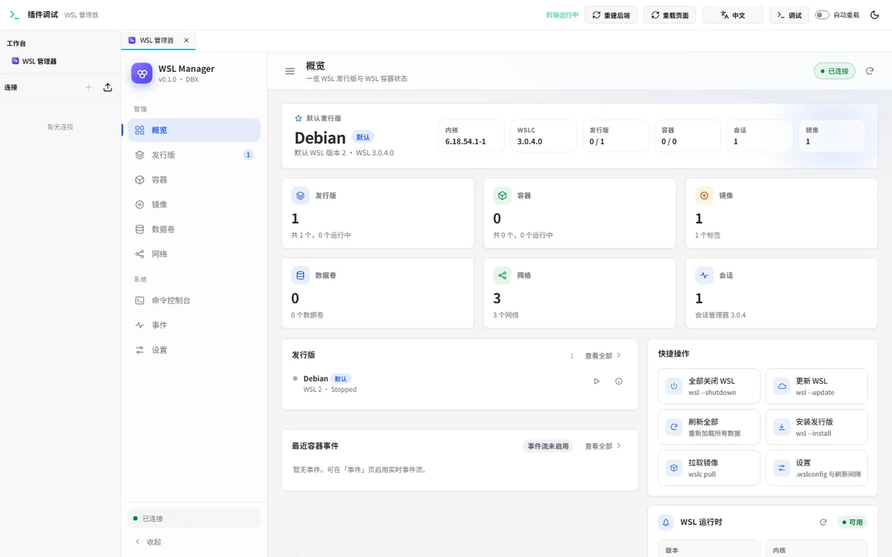
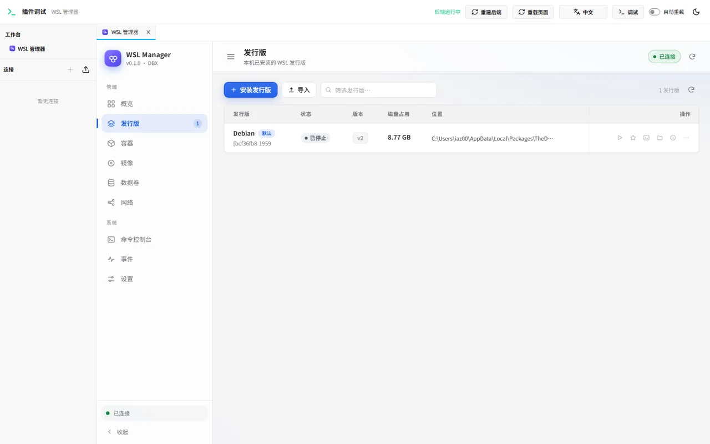
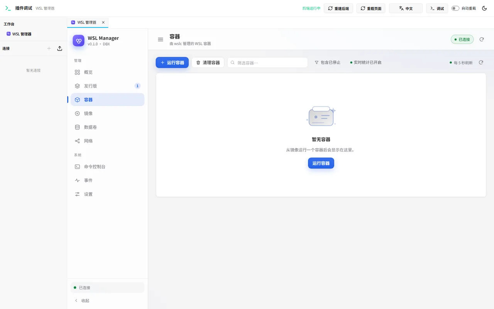
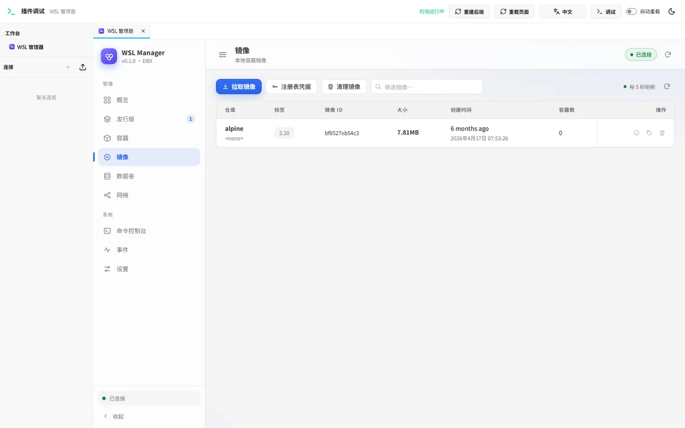
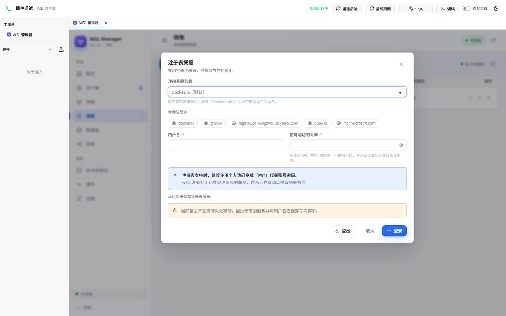
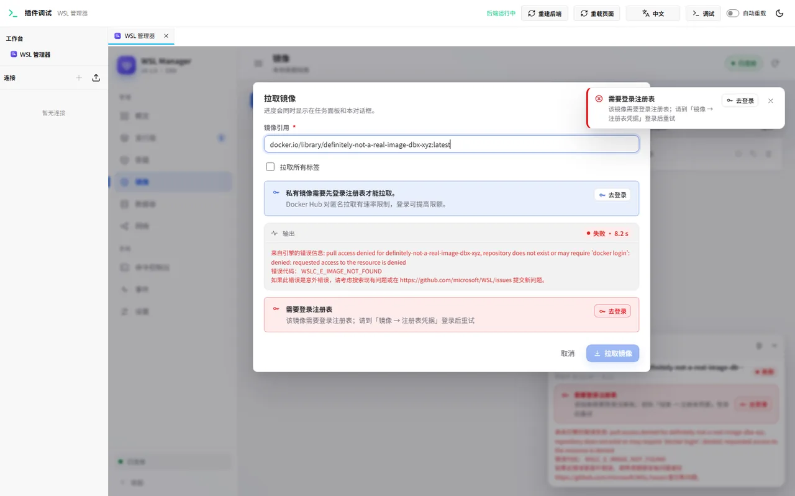
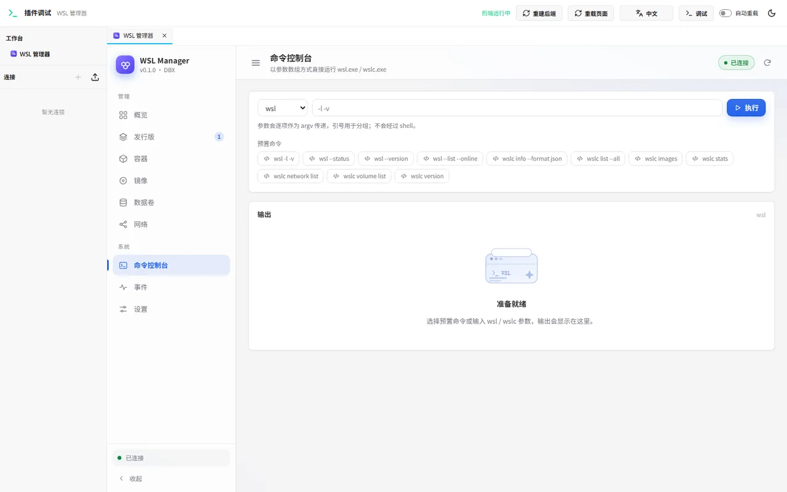
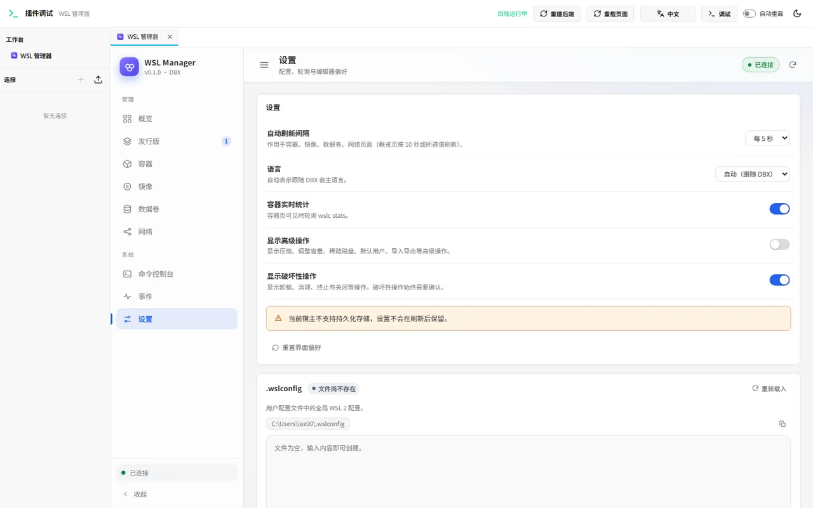

# WSL Manager for DBX

[简体中文](README.md) | English

A [DBX](https://dbxio.com/) plugin that provides a visual management surface for the Windows Subsystem for Linux:
WSL distributions (`wsl`) and WSL containers (`wslc`).

The plugin is a DBX package (`.dbxp`) made of a sandboxed workbench UI and a native Go sidecar. The sidecar runs with the
current user's privileges and invokes local WSL tools and Windows helpers as disclosed below.

## Features

**WSL distributions (`wsl`)**

- List distributions with live state, WSL version and VHD disk usage.
- Start, terminate, set the default distribution, switch WSL version.
- Keep distributions running after terminals close, restore default idle shutdown, or set custom timeouts. Configuration is backed up and restart requirements are shown. See the [idle-policy guide](docs/idle-policy.md).
- Manage default user, sparse VHD, compact and resize.
- Export, import, and unregister distributions (with confirmation).
- Inspect OS release, kernel, disk usage, IP addresses and `/etc/wsl.conf`.
- Open a terminal or Explorer at the distribution, run commands inside it.

**WSL containers (`wslc`)**

- Container list and lifecycle: run, start, stop, restart, kill, remove, prune.
- Logs (including follow mode), `exec`, live resource statistics.
- Images: list, pull with live progress, build, tag, save/load, remove, prune.
- Volumes and networks: create, inspect, remove, connect/disconnect, prune.
- Live `wslc events` stream.

**Registry credentials**

- Sign in/out to container registries from the plugin (equivalent to `docker login`), including Docker Hub, GHCR,
  Alibaba Cloud ACR and private `host:port` registries.
- Pull/build failures caused by missing credentials or Docker Hub rate limits are classified and surface a one-click
  "sign in" action with the registry prefilled.
- Passwords are passed to `wslc` over stdin and are never persisted, logged, or emitted in RPC errors.

**Other**

- Command console: run arbitrary `wsl` / `wslc` commands as argv (no shell), with stdout/stderr and exit code.
- Settings: visual editors for `.wslconfig` and wslc `settings.yaml`, with automatic backups.
- Overview dashboard, dark/light theme, English/Chinese UI, task panel with live logs and cancellation.

## AI and MCP

Four tools (`wsl_connections`, `wsl_describe`, `wsl_read`, `wsl_write`) expose all 73 existing management methods through the external DBX MCP service, including local distributions, containers, command/file access, images, volumes, networks, configuration, registries and jobs. Requires DBX 0.6.55+. Writes retain host/client authorization. The current built-in DBX agent discovers open connection-provider plugins only; this workbench plugin uses the external MCP surface. See the [MCP guide](docs/mcp.md).

## Screenshots

| Overview | Distributions |
| --- | --- |
|  |  |

| Containers | Images |
| --- | --- |
|  |  |

| Registry credentials | Pull authentication guidance |
| --- | --- |
|  |  |

| Command console | Settings |
| --- | --- |
|  |  |

Dark theme: [overview-dark.png](docs/screenshots/overview-dark.webp).

## Requirements

| Item | Requirement |
| --- | --- |
| OS | Windows 11 with WSL 2 (verified with WSL 3.0.3 and 3.0.4) |
| DBX | `>= 0.6.55` |
| WSL containers | `wslc` from WSL 3.0+; optional — distribution pages work without it |
| Build tools | Go 1.22+, Node.js 22+, `@dbx-app/plugin-cli` |

## Installation

### From the DBX Store

Open DBX → Plugin Center → search for **WSL Manager** → Install.

### From the GitHub Release (unsigned candidate)

1. Download `com.dbx.wsl-<version>-windows-x64.dbxp` from [Releases](https://github.com/w89588/dbx-plugin-wsl/releases).
2. In DBX → Plugin Center → Settings, enable **Allow unsigned development packages**.
3. Install the local `.dbxp` package.
4. Open **WSL Manager** from the plugin shortcut, command palette, or Plugin Center.

### From source

```powershell
npm install --no-audit --no-fund @dbx-app/plugin-cli
node node_modules\@dbx-app\plugin-cli\bin\dbx-plugin.js package .
```

The package is written to `dist/`. See [docs/installation.md](docs/installation.md) for troubleshooting (Chinese).

## Usage

- **Overview** — WSL/wslc versions, default distribution, running counts, quick actions, recent container events.
- **Distributions** — manage installed distributions; open the detail drawer for OS/kernel/disk/IP/`wsl.conf`.
- **Containers** — run containers, follow logs, execute commands, watch live stats.
- **Images** — pull/build/remove images; open **Registry credentials** when a private image or rate limit requires sign-in.
- **Volumes / Networks** — manage container storage and networking.
- **Command console** — run `wsl` / `wslc` commands argument-by-argument.
- **Events** — live container runtime events.
- **Settings** — `.wslconfig` / wslc `settings.yaml` editors, refresh interval, danger-zone options.

## Architecture

```
DBX host (sandboxed iframe)
  │  window.dbxPlugin.invoke / onEvent        Host API 1
  ▼
ui/index.html (single-file UI, no external assets)
  │  Sidecar Protocol v1 over stdio (JSON-RPC 2.0)
  ▼
Go sidecar (backend/)
  ├── wsl.exe   distributions
  └── wslc.exe  WSL containers
```

- Long-running operations are jobs with `job/output` / `job/end` events and cancellation.
- Commands are passed as argv arrays; no shell string concatenation.
- The UI is a single HTML file with inline CSS/JS, and persists preferences through `dbxPlugin.storage`.

Repository layout:

```
.
├── manifest.json            DBX plugin manifest (id, permissions, entrypoints, contributions)
├── dbx-plugin.toml          packaging configuration
├── assets/                  plugin icon
├── ui/index.html            sandboxed workbench UI
├── backend/                 Go sidecar (+ vendored DBX Go SDK)
├── docs/                    installation, releasing, RPC contract, screenshots
└── tools/                   manifest preflight and release metadata helpers
```

## Development

```powershell
# Run the browser development host (builds the Go sidecar; DBX not required)
node ..\node_modules\@dbx-app\plugin-cli\bin\dbx-plugin.js dev --path . --port 5190

# Backend tests
cd backend
go vet ./...; go test ./...

# Manifest install-time rules (menus.group etc.)
cd ..
node tools/manifest-check.mjs

# Build an unsigned candidate with release metadata
node tools/release-meta.mjs --package dist\<package>.dbxp --repo w89588/dbx-plugin-wsl --tag v<version> --publisher w89588
```

The RPC contract between the UI and the sidecar is documented in [docs/rpc-contract.md](docs/rpc-contract.md).
Release and store submission steps are in [docs/releasing.md](docs/releasing.md).

## Permissions and security

The manifest requests only:

- `host.workbench` — open the plugin workbench and set its title.
- `host.events` — receive sidecar job/event notifications.
- `host.binary` — execute local WSL tools and Windows helpers through the native sidecar.
- `host.storage` — persist small UI preferences (active tab, refresh interval, last registry server/username).

No network, filesystem, clipboard, database, connection or AI permissions are requested. The sandboxed UI has no
direct network access. The native sidecar runs as the current user and invokes `wsl.exe` / `wslc.exe`,
`wt.exe` (or `cmd.exe` as a terminal fallback), `explorer.exe`, and `taskkill` for process-tree cancellation. Registry
passwords are written to `wslc login --password-stdin` and never appear in argv, logs, events or errors.

Idle-policy updates write the current user's `.wslconfig` with a backup. Source / feedback buttons use Windows `ShellExecuteW`
to open fixed project or Microsoft documentation HTTPS URLs in the default browser; no logs are uploaded or Issues submitted automatically.

## Limitations

- Windows only (`windows-x64`).
- WSL 1 requires the optional Windows component; version switching otherwise offers WSL 2 only.
- `wslc` features depend on the installed WSL version.
- Export/import/build path fields accept Windows paths (no native file picker yet).
- `wslc` 3.0.3/3.0.4 cannot list signed-in registries, so registry state is confirmed by pull results.

## Contributing

[Source repository](https://github.com/w89588/dbx-plugin-wsl) · [Bugs and suggestions](https://github.com/w89588/dbx-plugin-wsl/issues).
The sidebar and Settings → About include repository and Issues links. Bug and feature forms are available on GitHub. Search existing Issues first;
include versions, reproduction steps, expected/actual behavior and redacted logs. Never include passwords or tokens.

Issues and pull requests are welcome. See [CONTRIBUTING.md](CONTRIBUTING.md) for build/test requirements and the
submission checklist.

## License

[Apache-2.0](LICENSE). The vendored DBX Go plugin SDK (`backend/sdk/dbx-plugin-sdk`) is Apache-2.0 licensed.

## v0.3.0

Resource changes stream over the existing host event bridge (not HTTP SSE). The UI patches existing rows and fields, preserving focus, scroll and drafts. Hidden views unsubscribe; visible views reconnect with a fresh snapshot. Sampling remains in the backend; unchanged data is not pushed. Configuration writes require the revision returned by `system/config/read`. Completed job history is limited to 32 jobs and 24 hours in the current sidecar; restarting the sidecar clears history.
