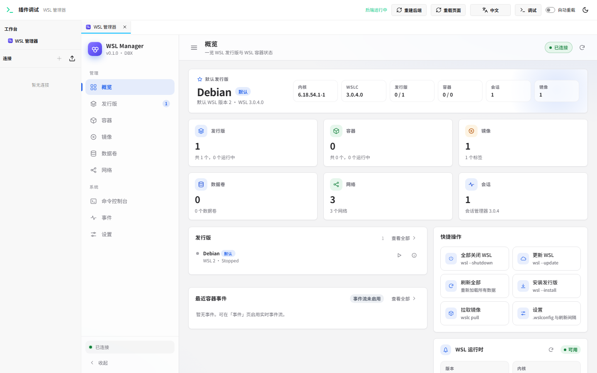
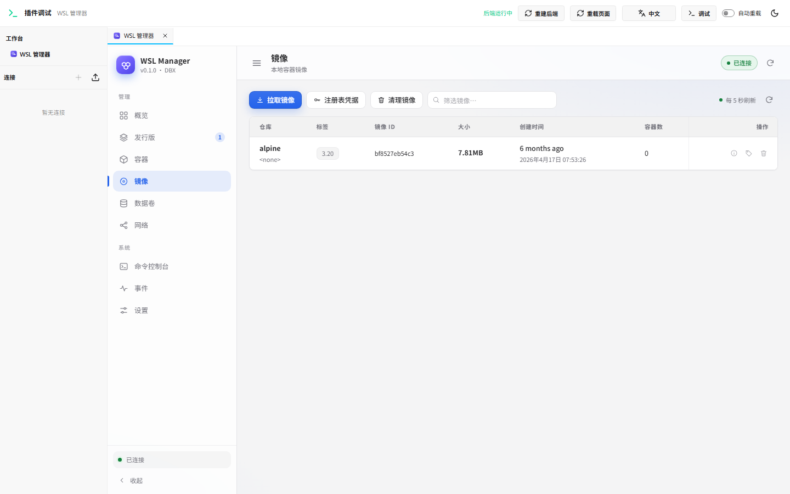
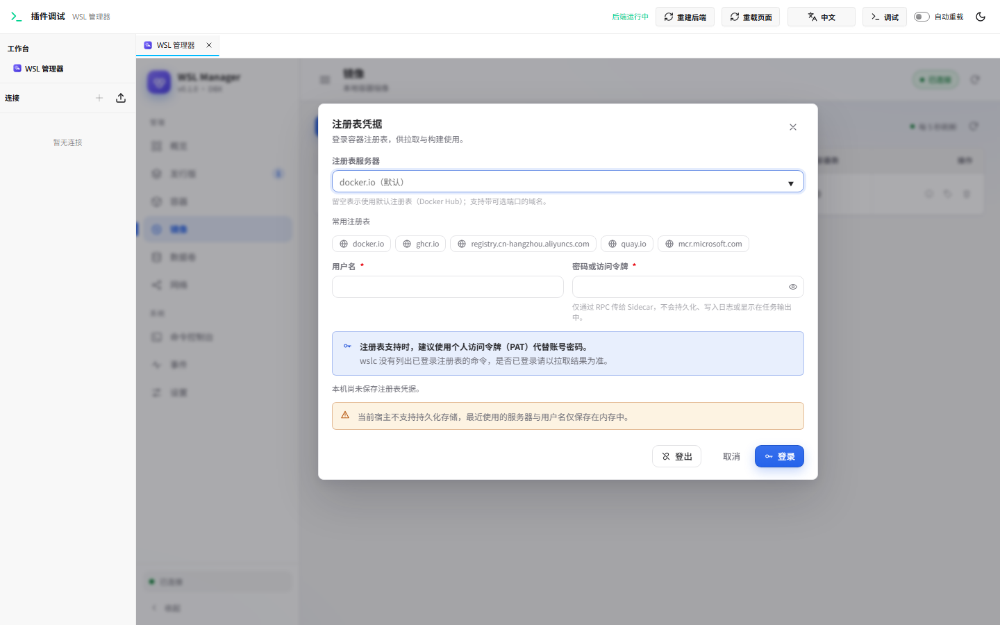
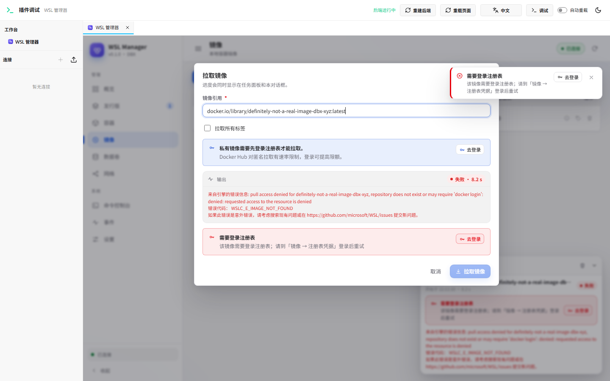

# WSL Manager · DBX 插件

在 DBX 中可视化管理 Windows 上的 **WSL 发行版（`wsl` 命令）** 与 **WSL 容器（`wslc` 命令）**。

- 发行版：列表、启动/停止、默认发行版、版本切换、导出/导入、卸载、磁盘占用、发行版信息（OS、内核、磁盘、IP、`/etc/wsl.conf`）、打开终端/资源管理器。
- WSL 容器：容器列表与生命周期、日志跟随、`exec`、资源占用、运行新容器；镜像拉取（实时日志）/删除/构建/标记；数据卷与网络管理；实时事件流。
- **注册表凭据**：镜像页可登录/登出容器注册表（Docker Hub、GHCR、阿里云 ACR、私有 `host:port`），密码经 stdin 交给 `wslc`、插件不保存；私有镜像或 Docker Hub 匿名限流导致拉取失败时，任务面板直接给出“去登录”入口。
- 命令控制台：以 argv 方式执行任意 `wsl` / `wslc` 命令并查看 stdout/stderr/退出码。
- 全局设置：`.wslconfig` 与 wslc `settings.yaml` 可视化编辑（自动备份）。

> 这是一个 **DBX 插件**（`.dbxp` 包），不是独立桌面应用。它由沙箱 UI + 原生 Go Sidecar 组成，Sidecar 在本机以当前用户权限调用 `wsl.exe` / `wslc.exe`。

**官方商店发布**：`v0.1.0`（publisher `w89588`，源码仓库 <https://github.com/w89588/dbx-plugin-wsl>，Release `v0.1.0`）。提交与签名流程见 [docs/releasing.md](docs/releasing.md)；商店安装需等待 DBX Store 审核签名。

## 环境要求

| 项 | 要求 |
| --- | --- |
| 操作系统 | Windows 11（WSL 2 / WSL 容器） |
| DBX | `>= 0.5.68`（本机验证版本 0.6.49） |
| WSL | `wsl --version` 可用（本机验证 3.0.3.0 / 3.0.4.0，内核 6.18） |
| WSL 容器（可选） | `wslc --version` 可用（WSL 3.0+ 自带）。不可用时插件仍可管理发行版 |
| 构建插件 | Go 1.22+、Node.js 22+、`@dbx-app/plugin-cli` |

## 安装

### 从官方商店（审核通过后）

DBX → 插件中心 → 搜索 **WSL Manager** → 安装。官方包由 DBX Store 审核后用仓库密钥签名，安装校验与普通商店插件一致。

### 从 Release / 本地未签名包

1. 下载或构建候选包（未签名）：

   ```powershell
   cd wsl-manager
   node ..\node_modules\@dbx-app\plugin-cli\bin\dbx-plugin.js package .
   ```

   产物：`dist/com.dbx.wsl-0.1.0-windows-x64.dbxp`（及 `.artifact.json`）；也可直接从 GitHub Release `v0.1.0` 下载。

2. 在 DBX 中打开 **插件中心 → 设置**，开启 **允许安装未签名开发包**（仅本地开发用；不放松官方商店校验）。

3. 在插件中心选择 **安装本地插件 / 从文件安装**，选中 `.dbxp`。

4. 安装后在以下任一入口打开 **WSL 管理器**：
   - 侧边栏/顶部工具栏的插件快捷入口；
   - 命令面板搜索 “WSL Manager / WSL 管理器”；
   - 插件中心 → 已安装 → WSL Manager → 打开工作台。

详细步骤与常见问题见 [docs/installation.md](docs/installation.md)。

## 开发

```powershell
cd wsl-manager

# 浏览器开发宿主（不需要启动 DBX），会构建 Go Sidecar
node ..\node_modules\@dbx-app\plugin-cli\bin\dbx-plugin.js dev --path . --port 5190

# 打开 http://127.0.0.1:5190/ ，在开发壳中选择 WSL Manager 工作台
```

调试：`curl "http://127.0.0.1:5190/api/diagnostics?after=0&limit=100"` 可读取脱敏后的 RPC 请求/响应/事件日志。

### 目录结构

```
wsl-manager/
├── manifest.json              # DBX 插件清单（id=com.dbx.wsl，权限/入口/贡献点）
├── dbx-plugin.toml            # 打包配置（[backend] go + [package] include）
├── assets/plugin.svg          # 插件图标
├── ui/index.html              # 单文件沙箱 UI（内联 CSS/JS，无外部依赖）
├── backend/
│   ├── main.go                # Sidecar 启动（stdio-jsonl）
│   ├── internal/…             # RPC 分发、wsl/wslc 解析、进程执行、长任务
│   ├── sdk/dbx-plugin-sdk/    # vendored DBX Go Sidecar SDK（Apache-2.0）
│   └── testdata/              # 解析测试 fixtures
├── docs/
│   ├── rpc-contract.md        # UI ↔ Sidecar RPC 契约（唯一接口约定）
│   └── installation.md        # 安装 / 排障
└── tools/, tests/             # QA 自动化（不进 .dbxp）
```

### 架构

```
DBX Host（沙箱 iframe）
   │  window.dbxPlugin.invoke / onEvent        ← Host API 1
   ▼
沙箱 UI（ui/index.html，单文件）
   │  Sidecar Protocol v1（stdio JSONL，JSON-RPC 2.0）
   ▼
Go Sidecar（backend/，DBX_PLUGIN_DATA_DIR）
   │  exec.Command + argv（无 shell 拼接）
   ├── wsl.exe   → 发行版
   └── wslc.exe  → WSL 容器
```

- UI 不直接访问操作系统；所有本地能力经 Sidecar。
- 长任务（pull/build/export/import/update/logs follow/events）通过 `job/output` / `job/end` / `wslc/event` 事件推送，可取消。
- 全部接口见 [docs/rpc-contract.md](docs/rpc-contract.md)。

## 安全设计

- 参数以独立 argv 传给 `wsl.exe` / `wslc.exe`，不拼接 Windows 命令行；控制台也只接受 `wsl` / `wslc`。
- 破坏性操作在 UI 二次确认；卸载发行版需输入发行版名称。
- `.wslconfig` / `settings.yaml` 写入前自动备份（同级 `.bak-<时间戳>`），原子替换。
- Sidecar 不记录凭据；v1 不提供 `wslc login`。
- 沙箱 UI 不使用 `localStorage`（opaque origin 会抛错），持久化走 `dbxPlugin.storage`。

## 验证

```powershell
# 后端单元测试 / vet
cd backend
$env:GOTMPDIR='..\.gotmp'; $env:GOCACHE='..\.gocache'
go vet ./...; go test ./...

# Manifest Host 规则预检（menus.group 词表等 schema 之外的安装期校验）
cd ..
node tools/manifest-check.mjs
node tools/manifest-check.mjs --package dist\com.dbx.wsl-0.1.0-windows-x64.dbxp

# 端到端（构建 sidecar → dev host → 真实 wsl/wslc RPC → Chrome headless 9 页 UI 校验 + 截图）
node tests/run-all.mjs
```

> 注意：`manifest.schema.json` 不包含 DBX Host 的全部安装期校验。例如 `menus.items[].group` 只允许
> `navigation` / `primary` / `secondary` / `destructive`（`commandPalette` 不能设置 `default_visible`）。
> 打包前请先跑 `tools/manifest-check.mjs`，否则导入时会报 `Plugin '...' is incompatible`。

已在真实机器（Windows 11 26H2 / WSL 3.0.3.0→3.0.4.0 / wslc 3.0.3→3.0.4 / Debian 13）验证：

| 项 | 结果 |
| --- | --- |
| `go vet ./...` / `go test ./...` / `go build ./...` | 全部通过 |
| Manifest Host 规则预检（含打包内 manifest） | 11/11 PASS |
| Sidecar 契约探针（真实 wsl/wslc，见 `docs/rpc-contract.md` §8） | **26/26 PASS** |
| 浏览器 UI 自动化（9 页切换 + 注册表凭据对话框/认证失败引导 + 截图 + console/exception 检查） | **81/81 PASS，0 console error** |
| Lead 独立冒烟（initialize/system/info/distros/exec/wslc/console/错误路径） | 10/10 PASS |
| 打包 | `dist/com.dbx.wsl-0.1.0-windows-x64.dbxp`（3,307,021 B，未签名候选） |
| 发布元数据 | `tools/release-meta.mjs` 生成 `release-candidates.json` / `store/candidates` / `store/publishers` |

产物校验：

```
manifest.json    id=com.dbx.wsl  version=0.1.0  publisher=w89588  permissions=host.workbench,host.events,host.storage
                 menus: commandPalette=primary, appToolbar=navigation
ui/index.html    321,026 B  sha256=0DD851C9B0ADDEF3CEC39DEF27973C4CB2EDE18608C4AFDC487826CBDCC8C878
.dbxp            sha256=cabc5dd6d44f8b9555fe46683b7d2309b8f3feaafd85d5ef301548cf44e672f4
```

QA 明细报告见 [docs/qa-report.md](docs/qa-report.md)；Release 资产独立校验见 [docs/release-verification.md](docs/release-verification.md)。

## 发布（官方商店）

1. 源码仓库：<https://github.com/w89588/dbx-plugin-wsl>（tag `v0.1.0`）。
2. Release `v0.1.0`：未签名 `.dbxp` + `.artifact.json` + `release-candidates.json`。
3. 商店提交：向 `t8y2/dbx-store` 提交 `publishers/w89588.json` + `candidates/com.dbx.wsl.json` 的 PR；CI 在签名前保持 `open candidate(s) awaiting DBX Store signing` 是预期状态，签名与合并由 DBX Store 维护者完成（作者不持有签名私钥）。
4. 可复现步骤与后续版本流程见 [docs/releasing.md](docs/releasing.md)。

## 界面预览

| 概览 | 发行版 |
| --- | --- |
|  |  |

| 容器 | 镜像 |
| --- | --- |
|  |  |

| 命令控制台 | 设置 |
| --- | --- |
|  |  |

| 注册表凭据（docker login） | 拉取认证失败引导 |
| --- | --- |
|  |  |

暗色主题、移动端、抽屉与对话框截图见 [tests/screenshots/](tests/screenshots/)。

## 已知限制

- 仅针对 Windows 目标构建（`windows-x64`）；DBX 其他平台不适用。
- WSL1 需要额外启用 Windows 可选组件；未启用时版本切换只提供 2。
- `wslc` 能力取决于本机 WSL 版本；较早 WSL 没有 `wslc` 时对应页面显示不可用提示。
- 导出/导入/构建等路径输入需要手动填写 Windows 路径（v1 未接入原生文件选择器）。
- 注册表凭据：`wslc 3.0.3/3.0.4` 没有“列出已登录注册表”的命令，插件只提供登录/登出，是否已登录以拉取结果为准；`REGISTRY_RATE_LIMITED`（Docker Hub 限流）分支仅单测覆盖，真实限流未主动触发；有效凭据成功后拉取私有镜像未纳入自动化（需要真实账号，避免凭据落盘）。
- 官方商店上架需要未签名候选包经 DBX Store 审核签名；本仓库只产出未签名候选包，签名与目录合并由维护者完成。

## License

[Apache-2.0](LICENSE)。`backend/sdk/dbx-plugin-sdk` 来自 DBX 官方 SDK（Apache-2.0）。
