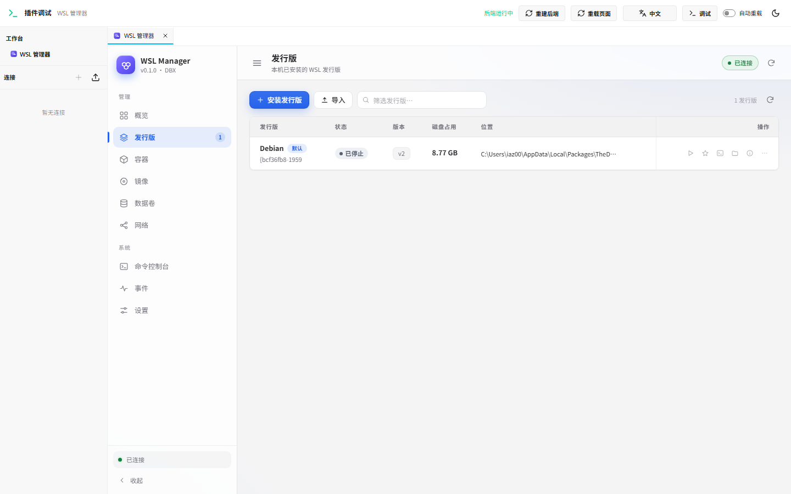
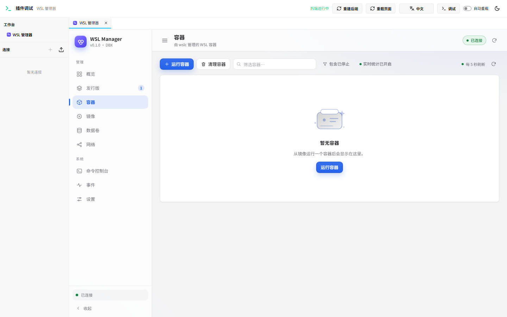
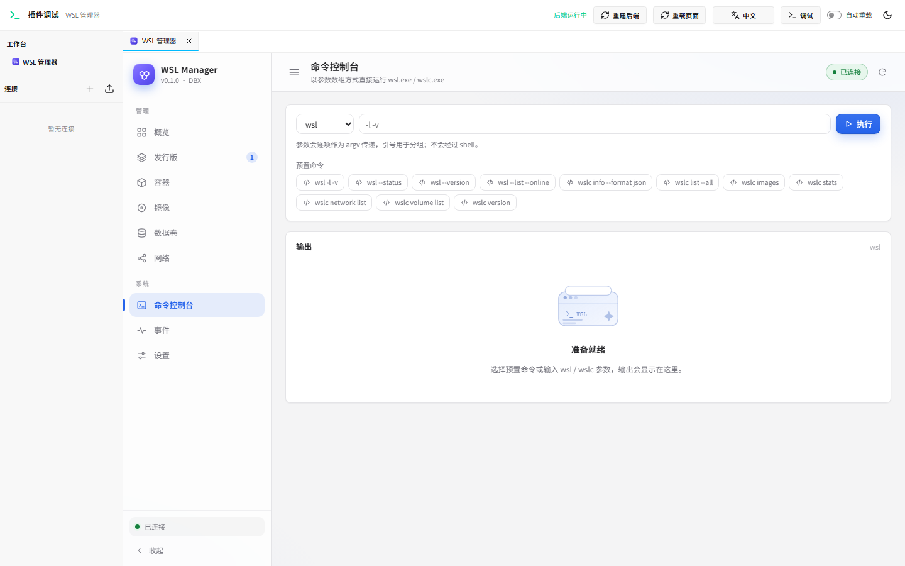
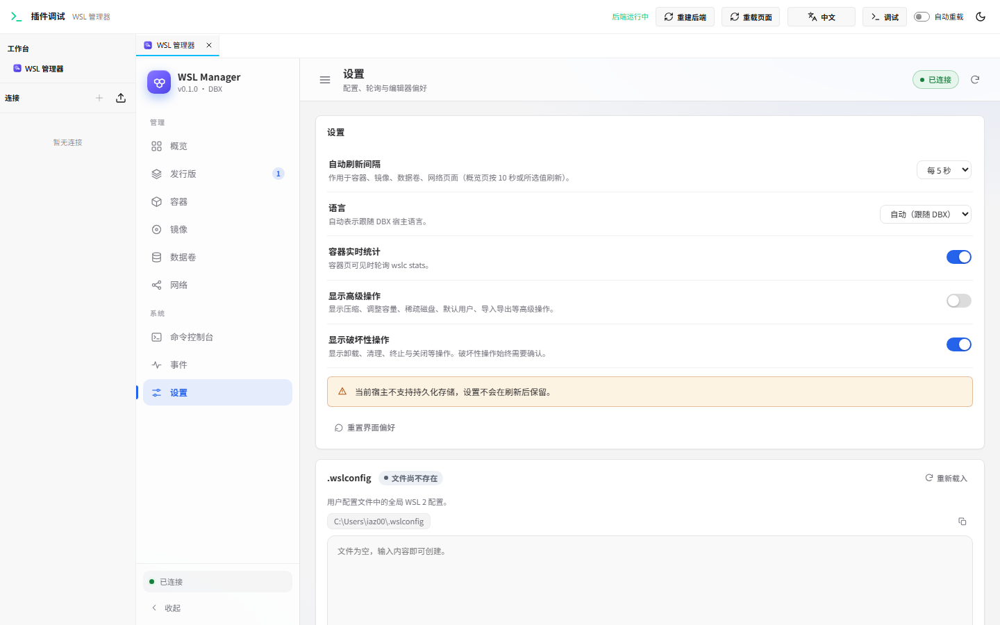

# WSL Manager for DBX

[English](README.md) | 简体中文

一个 [DBX](https://dbxio.com/) 插件，为 Windows Subsystem for Linux 提供可视化管理界面：
WSL 发行版（`wsl`）与 WSL 容器（`wslc`）。

插件是 DBX 包（`.dbxp`），由沙箱工作台 UI 和原生 Go Sidecar 组成。Sidecar 以当前用户权限运行，只调用本机的
`wsl.exe` / `wslc.exe`。

> 状态：`v0.1.0` 已提交 DBX 官方商店审核。在签名版本上架前，可在 DBX 中开启“允许安装未签名开发包”，
> 从 GitHub Release 安装未签名候选包。

## 功能

**WSL 发行版（`wsl`）**

- 发行版列表：实时状态、WSL 版本、VHD 磁盘占用。
- 启动、终止、设为默认、切换 WSL 版本。
- 默认用户、稀疏 VHD、压缩磁盘、调整容量。
- 导出、导入、卸载发行版（二次确认）。
- 查看 OS 版本、内核、磁盘、IP、`/etc/wsl.conf`。
- 打开终端 / 资源管理器，在发行版内执行命令。

**WSL 容器（`wslc`）**

- 容器列表与生命周期：运行、启动、停止、重启、终止、删除、清理。
- 日志（支持跟随）、`exec`、实时资源占用。
- 镜像：列表、拉取（实时进度）、构建、标记、保存/加载、删除、清理。
- 数据卷与网络：创建、检查、删除、连接/断开、清理。
- 实时 `wslc events` 事件流。

**注册表凭据**

- 在插件内登录/登出容器注册表（等价 `docker login`），支持 Docker Hub、GHCR、阿里云 ACR 及私有 `host:port`。
- 私有镜像或 Docker Hub 限流导致拉取/构建失败时，会给出分类原因与一键“去登录”入口，并预填 registry。
- 密码通过 stdin 传给 `wslc`，不持久化、不写日志、不出现在 RPC 错误中。

**其他**

- 命令控制台：以 argv 方式执行任意 `wsl` / `wslc` 命令（不经过 shell），显示 stdout/stderr 与退出码。
- 设置：可视化编辑 `.wslconfig` 与 wslc `settings.yaml`，自动备份。
- 概览仪表盘、明暗主题、中英文界面、带实时日志与取消功能的任务面板。

## 截图

| 概览 | 发行版 |
| --- | --- |
|  |  |

| 容器 | 镜像 |
| --- | --- |
|  |  |

| 注册表凭据 | 拉取认证失败引导 |
| --- | --- |
|  |  |

| 命令控制台 | 设置 |
| --- | --- |
|  |  |

暗色主题：[overview-dark.png](docs/screenshots/overview-dark.png)。

## 环境要求

| 项 | 要求 |
| --- | --- |
| 操作系统 | Windows 11 + WSL 2（已验证 WSL 3.0.3 / 3.0.4） |
| DBX | `>= 0.5.68`（已验证 0.6.49） |
| WSL 容器 | WSL 3.0+ 的 `wslc`，可选；缺失时发行版功能仍可用 |
| 构建工具 | Go 1.22+、Node.js 22+、`@dbx-app/plugin-cli` |

## 安装

### 官方商店

签名版本上架后：DBX → 插件中心 → 搜索 **WSL Manager** → 安装。

### GitHub Release（未签名候选）

1. 从 [Releases](https://github.com/w89588/dbx-plugin-wsl/releases) 下载 `com.dbx.wsl-<version>-windows-x64.dbxp`。
2. DBX → 插件中心 → 设置，开启 **允许安装未签名开发包**。
3. 安装本地 `.dbxp`。
4. 从插件快捷入口、命令面板或插件中心打开 **WSL Manager**。

### 从源码构建

```powershell
npm install --no-audit --no-fund @dbx-app/plugin-cli
node node_modules\@dbx-app\plugin-cli\bin\dbx-plugin.js package .
```

产物在 `dist/`。安装与排障见 [docs/installation.md](docs/installation.md)。

## 使用

- **概览**：WSL/wslc 版本、默认发行版、运行数量、快捷操作、最近容器事件。
- **发行版**：管理已安装发行版；详情抽屉包含 OS/内核/磁盘/IP/`wsl.conf`。
- **容器**：运行容器、跟随日志、执行命令、实时统计。
- **镜像**：拉取/构建/删除镜像；私有镜像或限流时打开 **注册表凭据** 登录。
- **数据卷 / 网络**：管理容器存储与网络。
- **命令控制台**：逐参数执行 `wsl` / `wslc` 命令。
- **事件**：容器运行时实时事件。
- **设置**：`.wslconfig` / `settings.yaml` 编辑器、刷新间隔、危险操作开关。

## 架构

```
DBX 宿主（沙箱 iframe）
  │  window.dbxPlugin.invoke / onEvent        Host API 1
  ▼
ui/index.html（单文件 UI，无外部资源）
  │  Sidecar Protocol v1（stdio，JSON-RPC 2.0）
  ▼
Go Sidecar（backend/）
  ├── wsl.exe   发行版
  └── wslc.exe  WSL 容器
```

- 长任务使用 job + `job/output` / `job/end` 事件，可取消。
- 命令以 argv 数组传递，不拼接 shell 字符串。
- UI 为单文件内联 CSS/JS，偏好通过 `dbxPlugin.storage` 持久化。

## 开发

```powershell
# 浏览器开发宿主（会构建 Go Sidecar，无需启动 DBX）
node ..\node_modules\@dbx-app\plugin-cli\bin\dbx-plugin.js dev --path . --port 5190

# 后端测试
cd backend
go vet ./...; go test ./...

# Manifest 安装期规则预检
cd ..
node tools/manifest-check.mjs

# 端到端：Sidecar RPC 探针 + headless Chrome UI 校验
node tests/run-all.mjs
```

UI 与 Sidecar 的 RPC 契约见 [docs/rpc-contract.md](docs/rpc-contract.md)；发布与商店提交流程见
[docs/releasing.md](docs/releasing.md)。

## 权限与安全

Manifest 只申请：

- `host.workbench`：打开插件工作台、设置标题。
- `host.events`：接收 Sidecar 任务/事件通知。
- `host.storage`：保存少量 UI 偏好（当前页签、刷新间隔、最近 registry server/username）。

不申请网络、文件系统、剪贴板、数据库、连接或 AI 权限。沙箱 UI 无直接网络访问。原生 Sidecar 以当前用户权限运行，
只启动 `wsl.exe` / `wslc.exe`；注册表密码通过 `wslc login --password-stdin` 传入，不进入 argv、日志、事件或错误信息。

## 已知限制

- 仅支持 Windows（`windows-x64`）。
- WSL 1 需要启用 Windows 可选组件；否则版本切换只提供 WSL 2。
- `wslc` 功能取决于本机 WSL 版本。
- 导出/导入/构建路径需填写 Windows 路径（暂未接入原生文件选择器）。
- `wslc` 3.0.3/3.0.4 无法列出已登录注册表，是否登录以拉取结果为准。
- GitHub Release 中为未签名候选包；DBX 商店版本由官方审核后签名。

## 贡献

欢迎 Issue 与 Pull Request。构建/测试要求与提交清单见 [CONTRIBUTING.md](CONTRIBUTING.md)。请勿向 `t8y2/dbx`
提交插件源码；商店元数据提交到 `t8y2/dbx-store`。

## 许可证

[Apache-2.0](LICENSE)。`backend/sdk/dbx-plugin-sdk` 为 DBX 官方 Apache-2.0 SDK。
